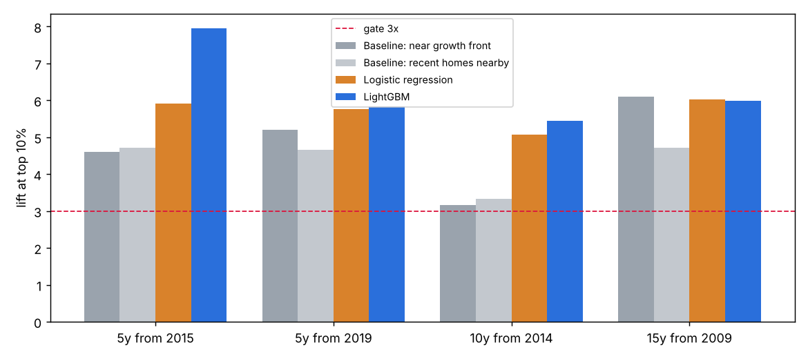
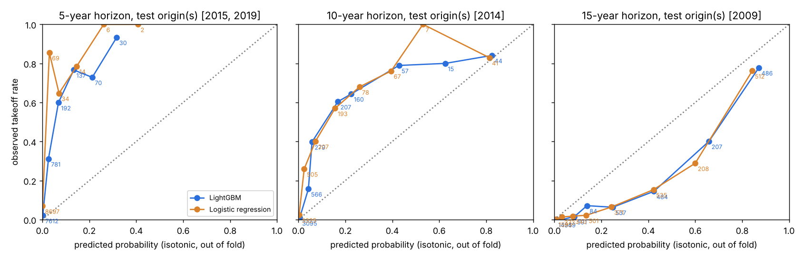
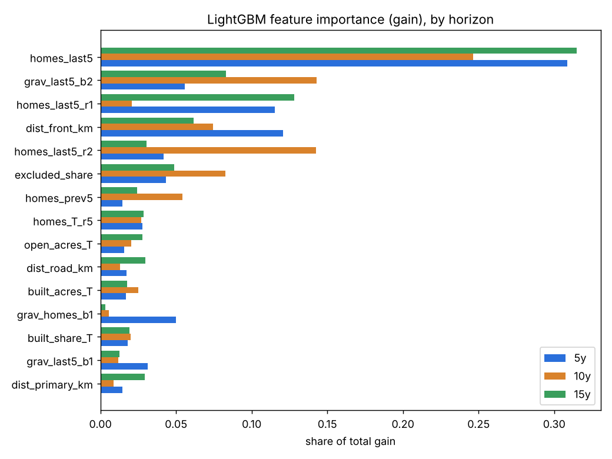

# 05. Backtest report and gate (T5)

## Verdict (5-year horizon, predicting from 2015, the PLAN gate cell)

1. **LightGBM, top 10% of hexes: lift 7.96x, capture 73.8% of new homes.**
2. Best baseline (Baseline: recent homes nearby), top 10%: lift 4.72x, capture 55.6%.
3. Gate: lift >= 3x AND better than both baselines on lift and capture.
4. **PASS** on the gate cell. Across all 4 test cells: 3 pass (5y/2015 PASS, 5y/2019 PASS, 10y/2014 PASS, 15y/2009 FAIL).
5. Caveat: past vacancy is rebuilt from the 2026 roll, so these numbers are an upper bound until checked against a historical roll (T7). Stop here for Guido's review.

### Every test cell

| Cell | LightGBM lift / capture top 10% | Best baseline lift / capture | Gate |
|---|---|---|---|
| 5y from 2015 | 7.96x / 73.8% | 4.72x / 55.6% (Baseline: recent homes nearby) | PASS |
| 5y from 2019 | 5.83x / 61.6% | 5.19x / 53.6% (Baseline: near growth front) | PASS |
| 10y from 2014 | 5.45x / 62.8% | 3.32x / 46.5% (Baseline: recent homes nearby) | PASS |
| 15y from 2009 | 5.99x / 54.9% | 6.09x / 55.2% (Baseline: near growth front) | FAIL |

## Distortions (docs/BACKTEST.md section 2)

1. **Parcel shapes are today's.** A tract that was one parcel at T may be 400 lots now. The model works in acres and homes per hex and uses no lot-count, lot-size or value feature.
2. **Demolitions are invisible.** A home torn down before 2026 never shows in the roll, so past stock is slightly undercounted. Small in Marion.
3. **The last years are incomplete.** 2026 has no homes and 2025 cannot be shown complete, so every window ends at 2024 (`LAST_FULL_YEAR`).
4. **Sales are censored**, worse than expected: the 2026 roll only holds 2025 and 2026 sales. No price result here is usable until historical SDF files are loaded (T7).

Also: **roads are TIGER 2020** (a leak for early origins). The LightGBM without the two road-distance features scores the same or better (table below), so the leak is not driving the result. I-75 and the Ocala distance are fixed geography.

## Leakage review

Checks run before reporting, looking for anything that lets the future into a feature.

- **As-of test passes** for every parcel-derived feature (`reports/03_features.md`).
- **Roads (2020):** removing them does not hurt (see the no-roads rows below).
- **`excluded_share` leaks, a little.** It uses 2026 codes, and 009 (subdivision common areas) and 094 (rights of way) appear when land is platted. Hexes with those codes took off far more often, so the feature can see future subdivisions. Removing it or rebuilding it without 009 and 094 moves top-10% lift by a few tenths and changes no gate result. The frozen v1 predictions keep it (they are never overwritten). **v2 should drop 009 and 094 from `excluded_share`.**

| Cell | Takeoff rate, hexes with > 5% of area in 009/094 | Other hexes |
|---|---|---|
| 5y from 2015 | 26.4% (277 hexes) | 3.9% |
| 5y from 2019 | 44.0% (273 hexes) | 8.4% |
| 10y from 2014 | 52.0% (277 hexes) | 9.8% |
| 15y from 2009 | 55.9% (279 hexes) | 10.2% |

| LightGBM variant | 5y/2015 | 5y/2019 | 10y/2014 | 15y/2009 |
|---|---|---|---|---|
| as frozen | 7.96x / 73.8% | 5.83x / 61.6% | 5.45x / 62.8% | 5.99x / 54.9% |
| without excluded_share | 7.83x / 73.4% | 5.58x / 59.2% | 5.46x / 62.1% | 6.10x / 55.8% |
| excluded_share without 009 and 094 | 8.00x / 73.3% | 5.73x / 59.4% | 5.15x / 60.1% | 6.03x / 57.1% |

- **Replaced homes look new.** A mobile home replaced in 2018 carries ACT_YR_BLT 2018, so the old home is missing at T and the new one counts as growth. This inflates takeoff in old mobile-home areas, the same family of error as demolitions.
- **Spatial overlap between train and test.** Test hexes are the same places as training hexes, later in time. That is the real use case (score Marion today), not a leak, but it says nothing yet about other counties (Phase 2 gate).

## All metrics, by horizon, test origin and model

Sample: hexes with >= 5 open acres at T. Lift and capture rank by the raw score. PR-AUC uses the raw score, Brier the calibrated probability (baselines are calibrated with isotonic on their training rows so they get a Brier too).

|   horizon |   origin | model                         |   hexes |   takeoffs | base_rate   | lift10   | capture10   | lift20   | capture20   |   pr_auc |   brier |
|----------:|---------:|:------------------------------|--------:|-----------:|:------------|:---------|:------------|:---------|:------------|---------:|--------:|
|         5 |     2015 | Baseline: near growth front   |    4421 |        235 | 5.3%        | 4.60x    | 54.2%       | 3.32x    | 68.3%       |    0.335 |   0.045 |
|         5 |     2015 | Baseline: recent homes nearby |    4421 |        235 | 5.3%        | 4.72x    | 55.6%       | 3.25x    | 70.3%       |    0.277 |   0.048 |
|         5 |     2015 | LightGBM                      |    4421 |        235 | 5.3%        | 7.96x    | 73.8%       | 4.83x    | 86.0%       |    0.54  |   0.047 |
|         5 |     2015 | LightGBM, no 2020 roads       |    4421 |        235 | 5.3%        | 8.13x    | 73.9%       | 4.85x    | 85.9%       |    0.555 |   0.047 |
|         5 |     2015 | Logistic regression           |    4421 |        235 | 5.3%        | 5.91x    | 62.7%       | 4.13x    | 77.8%       |    0.435 |   0.053 |
|         5 |     2019 | Baseline: near growth front   |    4401 |        468 | 10.6%       | 5.19x    | 53.6%       | 3.53x    | 76.1%       |    0.556 |   0.076 |
|         5 |     2019 | Baseline: recent homes nearby |    4401 |        468 | 10.6%       | 4.66x    | 56.9%       | 3.71x    | 78.0%       |    0.476 |   0.083 |
|         5 |     2019 | LightGBM                      |    4401 |        468 | 10.6%       | 5.83x    | 61.6%       | 3.93x    | 83.1%       |    0.638 |   0.092 |
|         5 |     2019 | LightGBM, no 2020 roads       |    4401 |        468 | 10.6%       | 5.96x    | 62.4%       | 3.97x    | 82.9%       |    0.652 |   0.09  |
|         5 |     2019 | Logistic regression           |    4401 |        468 | 10.6%       | 5.77x    | 62.8%       | 3.79x    | 79.0%       |    0.608 |   0.103 |
|        10 |     2014 | Baseline: near growth front   |    4423 |        549 | 12.4%       | 3.17x    | 44.4%       | 2.46x    | 60.5%       |    0.382 |   0.102 |
|        10 |     2014 | Baseline: recent homes nearby |    4423 |        549 | 12.4%       | 3.32x    | 46.5%       | 2.60x    | 60.7%       |    0.349 |   0.108 |
|        10 |     2014 | LightGBM                      |    4423 |        549 | 12.4%       | 5.45x    | 62.8%       | 4.23x    | 84.2%       |    0.66  |   0.088 |
|        10 |     2014 | LightGBM, no 2020 roads       |    4423 |        549 | 12.4%       | 5.65x    | 63.8%       | 4.30x    | 82.9%       |    0.666 |   0.092 |
|        10 |     2014 | Logistic regression           |    4423 |        549 | 12.4%       | 5.07x    | 59.2%       | 3.95x    | 81.0%       |    0.614 |   0.094 |
|        15 |     2009 | Baseline: near growth front   |    4433 |        581 | 13.1%       | 6.09x    | 55.2%       | 4.06x    | 76.3%       |    0.691 |   0.069 |
|        15 |     2009 | Baseline: recent homes nearby |    4433 |        581 | 13.1%       | 4.71x    | 57.3%       | 3.68x    | 77.9%       |    0.55  |   0.092 |
|        15 |     2009 | LightGBM                      |    4433 |        581 | 13.1%       | 5.99x    | 54.9%       | 4.29x    | 81.0%       |    0.769 |   0.071 |
|        15 |     2009 | LightGBM, no 2020 roads       |    4433 |        581 | 13.1%       | 6.10x    | 53.6%       | 4.32x    | 82.1%       |    0.779 |   0.07  |
|        15 |     2009 | Logistic regression           |    4433 |        581 | 13.1%       | 6.02x    | 55.0%       | 4.13x    | 75.6%       |    0.768 |   0.074 |

## "Not obvious" slice: hexes more than 2 km from the growth front at T

Lift here is relative to the slice's own base rate. This is where an edge would be, since land near the front is already priced.

|   horizon |   origin | model                         |   hexes |   takeoffs | base_rate   | lift10   | capture10   | lift20   | capture20   |   pr_auc |   brier |
|----------:|---------:|:------------------------------|--------:|-----------:|:------------|:---------|:------------|:---------|:------------|---------:|--------:|
|         5 |     2015 | Baseline: near growth front   |    3979 |        127 | 3.2%        | 3.39x    | 26.5%       | 3.03x    | 52.0%       |    0.116 |   0.031 |
|         5 |     2015 | Baseline: recent homes nearby |    3979 |        127 | 3.2%        | 3.30x    | 33.0%       | 2.54x    | 50.5%       |    0.142 |   0.032 |
|         5 |     2015 | LightGBM                      |    3979 |        127 | 3.2%        | 8.58x    | 64.2%       | 4.88x    | 77.6%       |    0.409 |   0.03  |
|         5 |     2015 | LightGBM, no 2020 roads       |    3979 |        127 | 3.2%        | 9.13x    | 65.4%       | 4.92x    | 77.9%       |    0.419 |   0.03  |
|         5 |     2015 | Logistic regression           |    3979 |        127 | 3.2%        | 6.38x    | 49.9%       | 4.33x    | 68.9%       |    0.245 |   0.032 |
|         5 |     2019 | Baseline: near growth front   |    3460 |        128 | 3.7%        | 2.19x    | 26.1%       | 1.56x    | 39.1%       |    0.064 |   0.036 |
|         5 |     2019 | Baseline: recent homes nearby |    3460 |        128 | 3.7%        | 5.17x    | 34.4%       | 3.42x    | 49.0%       |    0.246 |   0.036 |
|         5 |     2019 | LightGBM                      |    3460 |        128 | 3.7%        | 5.16x    | 46.3%       | 3.32x    | 59.5%       |    0.197 |   0.036 |
|         5 |     2019 | LightGBM, no 2020 roads       |    3460 |        128 | 3.7%        | 5.23x    | 47.4%       | 3.40x    | 60.5%       |    0.198 |   0.036 |
|         5 |     2019 | Logistic regression           |    3460 |        128 | 3.7%        | 3.44x    | 30.3%       | 2.70x    | 49.7%       |    0.114 |   0.037 |
|        10 |     2014 | Baseline: near growth front   |    4045 |        394 | 9.7%        | 2.27x    | 24.7%       | 2.45x    | 53.1%       |    0.232 |   0.09  |
|        10 |     2014 | Baseline: recent homes nearby |    4045 |        394 | 9.7%        | 2.89x    | 29.7%       | 2.13x    | 43.3%       |    0.229 |   0.094 |
|        10 |     2014 | LightGBM                      |    4045 |        394 | 9.7%        | 6.68x    | 65.0%       | 4.47x    | 84.4%       |    0.661 |   0.077 |
|        10 |     2014 | LightGBM, no 2020 roads       |    4045 |        394 | 9.7%        | 6.87x    | 65.7%       | 4.52x    | 80.5%       |    0.673 |   0.081 |
|        10 |     2014 | Logistic regression           |    4045 |        394 | 9.7%        | 5.80x    | 60.0%       | 4.11x    | 77.6%       |    0.615 |   0.082 |
|        15 |     2009 | Baseline: near growth front   |    2772 |         30 | 1.1%        | 2.73x    | 21.2%       | 2.50x    | 37.5%       |    0.03  |   0.013 |
|        15 |     2009 | Baseline: recent homes nearby |    2772 |         30 | 1.1%        | 5.23x    | 32.0%       | 3.37x    | 48.4%       |    0.091 |   0.018 |
|        15 |     2009 | LightGBM                      |    2772 |         30 | 1.1%        | 6.67x    | 40.8%       | 4.33x    | 60.4%       |    0.102 |   0.02  |
|        15 |     2009 | LightGBM, no 2020 roads       |    2772 |         30 | 1.1%        | 6.33x    | 40.2%       | 4.50x    | 60.4%       |    0.141 |   0.02  |
|        15 |     2009 | Logistic regression           |    2772 |         30 | 1.1%        | 7.00x    | 38.9%       | 4.00x    | 52.9%       |    0.101 |   0.019 |

## Per training period (5-year horizon, one training origin at a time)

2005 trains on the crash (2005 to 2010 windows). 2010 trains on the bottom.

|   train origin |   test origin | model                         |   hexes |   takeoffs | base_rate   | lift10   | capture10   | lift20   | capture20   |   pr_auc |   brier |
|---------------:|--------------:|:------------------------------|--------:|-----------:|:------------|:---------|:------------|:---------|:------------|---------:|--------:|
|           1995 |          2015 | Baseline: near growth front   |    4421 |        235 | 5.3%        | 4.60x    | 54.2%       | 3.32x    | 68.3%       |    0.335 |   0.044 |
|           1995 |          2015 | Baseline: recent homes nearby |    4421 |        235 | 5.3%        | 4.72x    | 55.6%       | 3.25x    | 70.3%       |    0.277 |   0.047 |
|           1995 |          2015 | Logistic regression           |    4421 |        235 | 5.3%        | 7.15x    | 69.2%       | 4.60x    | 83.4%       |    0.503 |   0.044 |
|           1995 |          2015 | LightGBM                      |    4421 |        235 | 5.3%        | 7.40x    | 67.6%       | 4.87x    | 86.3%       |    0.518 |   0.043 |
|           1995 |          2019 | Baseline: near growth front   |    4401 |        468 | 10.6%       | 5.19x    | 53.6%       | 3.53x    | 76.1%       |    0.556 |   0.072 |
|           1995 |          2019 | Baseline: recent homes nearby |    4401 |        468 | 10.6%       | 4.66x    | 56.9%       | 3.71x    | 78.0%       |    0.476 |   0.077 |
|           1995 |          2019 | Logistic regression           |    4401 |        468 | 10.6%       | 5.38x    | 60.2%       | 3.59x    | 76.7%       |    0.565 |   0.084 |
|           1995 |          2019 | LightGBM                      |    4401 |        468 | 10.6%       | 6.09x    | 63.3%       | 3.92x    | 82.7%       |    0.653 |   0.071 |
|           2000 |          2015 | Baseline: near growth front   |    4421 |        235 | 5.3%        | 4.60x    | 54.2%       | 3.32x    | 68.3%       |    0.335 |   0.043 |
|           2000 |          2015 | Baseline: recent homes nearby |    4421 |        235 | 5.3%        | 4.72x    | 55.6%       | 3.25x    | 70.3%       |    0.277 |   0.047 |
|           2000 |          2015 | Logistic regression           |    4421 |        235 | 5.3%        | 5.91x    | 60.0%       | 4.11x    | 78.8%       |    0.439 |   0.046 |
|           2000 |          2015 | LightGBM                      |    4421 |        235 | 5.3%        | 7.49x    | 68.2%       | 4.83x    | 84.9%       |    0.508 |   0.041 |
|           2000 |          2019 | Baseline: near growth front   |    4401 |        468 | 10.6%       | 5.19x    | 53.6%       | 3.53x    | 76.1%       |    0.556 |   0.07  |
|           2000 |          2019 | Baseline: recent homes nearby |    4401 |        468 | 10.6%       | 4.66x    | 56.9%       | 3.71x    | 78.0%       |    0.476 |   0.077 |
|           2000 |          2019 | Logistic regression           |    4401 |        468 | 10.6%       | 5.79x    | 61.1%       | 3.70x    | 77.5%       |    0.606 |   0.071 |
|           2000 |          2019 | LightGBM                      |    4401 |        468 | 10.6%       | 6.07x    | 66.4%       | 3.99x    | 82.9%       |    0.669 |   0.064 |
|           2005 |          2015 | Baseline: near growth front   |    4421 |        235 | 5.3%        | 4.60x    | 54.2%       | 3.32x    | 68.3%       |    0.335 |   0.044 |
|           2005 |          2015 | Baseline: recent homes nearby |    4421 |        235 | 5.3%        | 4.72x    | 55.6%       | 3.25x    | 70.3%       |    0.277 |   0.048 |
|           2005 |          2015 | Logistic regression           |    4421 |        235 | 5.3%        | 4.38x    | 47.5%       | 3.02x    | 63.1%       |    0.319 |   0.048 |
|           2005 |          2015 | LightGBM                      |    4421 |        235 | 5.3%        | 7.11x    | 67.2%       | 4.68x    | 84.3%       |    0.476 |   0.045 |
|           2005 |          2019 | Baseline: near growth front   |    4401 |        468 | 10.6%       | 5.19x    | 53.6%       | 3.53x    | 76.1%       |    0.556 |   0.073 |
|           2005 |          2019 | Baseline: recent homes nearby |    4401 |        468 | 10.6%       | 4.66x    | 56.9%       | 3.71x    | 78.0%       |    0.476 |   0.082 |
|           2005 |          2019 | Logistic regression           |    4401 |        468 | 10.6%       | 5.37x    | 49.9%       | 3.40x    | 62.0%       |    0.47  |   0.08  |
|           2005 |          2019 | LightGBM                      |    4401 |        468 | 10.6%       | 6.13x    | 62.8%       | 4.03x    | 82.3%       |    0.677 |   0.062 |
|           2010 |          2015 | Baseline: near growth front   |    4421 |        235 | 5.3%        | 4.60x    | 54.2%       | 3.32x    | 68.3%       |    0.335 |   0.051 |
|           2010 |          2015 | Baseline: recent homes nearby |    4421 |        235 | 5.3%        | 4.72x    | 55.6%       | 3.25x    | 70.3%       |    0.277 |   0.052 |
|           2010 |          2015 | Logistic regression           |    4421 |        235 | 5.3%        | 6.09x    | 63.5%       | 3.96x    | 76.7%       |    0.422 |   0.048 |
|           2010 |          2015 | LightGBM                      |    4421 |        235 | 5.3%        | 5.79x    | 61.6%       | 3.96x    | 75.6%       |    0.418 |   0.048 |
|           2010 |          2019 | Baseline: near growth front   |    4401 |        468 | 10.6%       | 5.19x    | 53.6%       | 3.53x    | 76.1%       |    0.556 |   0.098 |
|           2010 |          2019 | Baseline: recent homes nearby |    4401 |        468 | 10.6%       | 4.66x    | 56.9%       | 3.71x    | 78.0%       |    0.476 |   0.101 |
|           2010 |          2019 | Logistic regression           |    4401 |        468 | 10.6%       | 2.91x    | 33.1%       | 2.75x    | 57.3%       |    0.255 |   0.099 |
|           2010 |          2019 | LightGBM                      |    4401 |        468 | 10.6%       | 5.62x    | 60.7%       | 3.64x    | 74.3%       |    0.576 |   0.093 |

## Takeoff threshold sensitivity (5 and 25 new homes, primary is 10)

|   threshold |   horizon |   origin | model                         | base_rate   | lift10   | capture10   |
|------------:|----------:|---------:|:------------------------------|:------------|:---------|:------------|
|           5 |         5 |     2015 | Baseline: near growth front   | 8.3%        | 3.84x    | 54.2%       |
|           5 |         5 |     2015 | Baseline: recent homes nearby | 8.3%        | 3.79x    | 55.6%       |
|           5 |         5 |     2015 | LightGBM                      | 8.3%        | 6.29x    | 68.5%       |
|           5 |         5 |     2019 | Baseline: near growth front   | 15.4%       | 4.10x    | 53.6%       |
|           5 |         5 |     2019 | Baseline: recent homes nearby | 15.4%       | 3.64x    | 56.9%       |
|           5 |         5 |     2019 | LightGBM                      | 15.4%       | 4.60x    | 60.8%       |
|           5 |        10 |     2014 | Baseline: near growth front   | 19.3%       | 2.59x    | 44.4%       |
|           5 |        10 |     2014 | Baseline: recent homes nearby | 19.3%       | 2.75x    | 46.5%       |
|           5 |        10 |     2014 | LightGBM                      | 19.3%       | 3.91x    | 51.7%       |
|           5 |        15 |     2009 | Baseline: near growth front   | 21.2%       | 4.20x    | 55.2%       |
|           5 |        15 |     2009 | Baseline: recent homes nearby | 21.2%       | 3.31x    | 57.3%       |
|           5 |        15 |     2009 | LightGBM                      | 21.2%       | 4.26x    | 50.9%       |
|          25 |         5 |     2015 | Baseline: near growth front   | 2.6%        | 6.19x    | 54.2%       |
|          25 |         5 |     2015 | Baseline: recent homes nearby | 2.6%        | 6.42x    | 55.6%       |
|          25 |         5 |     2015 | LightGBM                      | 2.6%        | 8.14x    | 67.0%       |
|          25 |         5 |     2019 | Baseline: near growth front   | 6.6%        | 6.04x    | 53.6%       |
|          25 |         5 |     2019 | Baseline: recent homes nearby | 6.6%        | 5.62x    | 56.9%       |
|          25 |         5 |     2019 | LightGBM                      | 6.6%        | 6.72x    | 60.8%       |
|          25 |        10 |     2014 | Baseline: near growth front   | 8.0%        | 3.92x    | 44.4%       |
|          25 |        10 |     2014 | Baseline: recent homes nearby | 8.0%        | 4.16x    | 46.5%       |
|          25 |        10 |     2014 | LightGBM                      | 8.0%        | 6.83x    | 62.7%       |
|          25 |        15 |     2009 | Baseline: near growth front   | 8.3%        | 6.99x    | 55.2%       |
|          25 |        15 |     2009 | Baseline: recent homes nearby | 8.3%        | 6.08x    | 57.3%       |
|          25 |        15 |     2009 | LightGBM                      | 8.3%        | 7.34x    | 63.8%       |

## Border hexes (within 10 km of the county line) versus interior

Feature values near the border miss the neighbour counties (fixed in T6).

|   horizon |   origin |   border_flag | model                         |   hexes |   takeoffs | base_rate   | lift10   | capture10   | lift20   | capture20   |   pr_auc |   brier |
|----------:|---------:|--------------:|:------------------------------|--------:|-----------:|:------------|:---------|:------------|:---------|:------------|---------:|--------:|
|         5 |     2015 |             0 | Baseline: near growth front   |    1873 |        154 | 8.2%        | 3.83x    | 52.2%       | 2.79x    | 64.7%       |    0.375 |   0.067 |
|         5 |     2015 |             0 | Baseline: recent homes nearby |    1873 |        154 | 8.2%        | 3.66x    | 46.6%       | 2.92x    | 68.5%       |    0.329 |   0.073 |
|         5 |     2015 |             0 | LightGBM                      |    1873 |        154 | 8.2%        | 5.91x    | 66.1%       | 4.64x    | 86.6%       |    0.563 |   0.072 |
|         5 |     2015 |             0 | LightGBM, no 2020 roads       |    1873 |        154 | 8.2%        | 5.91x    | 65.4%       | 4.55x    | 85.4%       |    0.579 |   0.071 |
|         5 |     2015 |             0 | Logistic regression           |    1873 |        154 | 8.2%        | 5.06x    | 59.9%       | 3.49x    | 76.0%       |    0.471 |   0.082 |
|         5 |     2015 |             1 | Baseline: near growth front   |    2548 |         81 | 3.2%        | 4.57x    | 43.4%       | 4.51x    | 72.2%       |    0.261 |   0.029 |
|         5 |     2015 |             1 | Baseline: recent homes nearby |    2548 |         81 | 3.2%        | 4.43x    | 41.8%       | 2.65x    | 53.5%       |    0.17  |   0.03  |
|         5 |     2015 |             1 | LightGBM                      |    2548 |         81 | 3.2%        | 9.14x    | 68.3%       | 4.94x    | 80.1%       |    0.511 |   0.029 |
|         5 |     2015 |             1 | LightGBM, no 2020 roads       |    2548 |         81 | 3.2%        | 9.26x    | 69.3%       | 4.94x    | 81.5%       |    0.543 |   0.029 |
|         5 |     2015 |             1 | Logistic regression           |    2548 |         81 | 3.2%        | 8.02x    | 62.2%       | 4.57x    | 74.1%       |    0.421 |   0.032 |
|         5 |     2019 |             0 | Baseline: near growth front   |    1858 |        257 | 13.8%       | 4.75x    | 39.8%       | 3.46x    | 68.6%       |    0.594 |   0.092 |
|         5 |     2019 |             0 | Baseline: recent homes nearby |    1858 |        257 | 13.8%       | 4.04x    | 53.6%       | 3.23x    | 74.0%       |    0.506 |   0.101 |
|         5 |     2019 |             0 | LightGBM                      |    1858 |        257 | 13.8%       | 5.13x    | 53.3%       | 3.56x    | 69.8%       |    0.657 |   0.115 |
|         5 |     2019 |             0 | LightGBM, no 2020 roads       |    1858 |        257 | 13.8%       | 5.21x    | 57.3%       | 3.60x    | 74.2%       |    0.668 |   0.112 |
|         5 |     2019 |             0 | Logistic regression           |    1858 |        257 | 13.8%       | 5.28x    | 55.0%       | 3.54x    | 73.8%       |    0.623 |   0.131 |
|         5 |     2019 |             1 | Baseline: near growth front   |    2543 |        211 | 8.3%        | 5.92x    | 62.9%       | 3.44x    | 71.1%       |    0.528 |   0.065 |
|         5 |     2019 |             1 | Baseline: recent homes nearby |    2543 |        211 | 8.3%        | 6.20x    | 65.4%       | 4.00x    | 78.1%       |    0.49  |   0.07  |
|         5 |     2019 |             1 | LightGBM                      |    2543 |        211 | 8.3%        | 6.82x    | 68.7%       | 4.10x    | 79.0%       |    0.665 |   0.075 |
|         5 |     2019 |             1 | LightGBM, no 2020 roads       |    2543 |        211 | 8.3%        | 6.84x    | 68.7%       | 4.15x    | 79.6%       |    0.676 |   0.073 |
|         5 |     2019 |             1 | Logistic regression           |    2543 |        211 | 8.3%        | 6.68x    | 67.9%       | 3.74x    | 74.3%       |    0.662 |   0.082 |
|        10 |     2014 |             0 | Baseline: near growth front   |    1873 |        318 | 17.0%       | 2.80x    | 40.9%       | 2.26x    | 59.0%       |    0.427 |   0.132 |
|        10 |     2014 |             0 | Baseline: recent homes nearby |    1873 |        318 | 17.0%       | 2.84x    | 43.8%       | 2.48x    | 63.4%       |    0.432 |   0.141 |
|        10 |     2014 |             0 | LightGBM                      |    1873 |        318 | 17.0%       | 4.22x    | 56.3%       | 3.61x    | 77.2%       |    0.669 |   0.115 |
|        10 |     2014 |             0 | LightGBM, no 2020 roads       |    1873 |        318 | 17.0%       | 4.03x    | 52.6%       | 3.60x    | 76.6%       |    0.665 |   0.122 |
|        10 |     2014 |             0 | Logistic regression           |    1873 |        318 | 17.0%       | 4.13x    | 51.0%       | 3.35x    | 76.1%       |    0.645 |   0.123 |
|        10 |     2014 |             1 | Baseline: near growth front   |    2550 |        231 | 9.1%        | 3.16x    | 34.9%       | 3.23x    | 68.7%       |    0.319 |   0.08  |
|        10 |     2014 |             1 | Baseline: recent homes nearby |    2550 |        231 | 9.1%        | 3.02x    | 29.7%       | 2.11x    | 42.0%       |    0.227 |   0.084 |
|        10 |     2014 |             1 | LightGBM                      |    2550 |        231 | 9.1%        | 7.14x    | 71.4%       | 4.68x    | 85.5%       |    0.662 |   0.068 |
|        10 |     2014 |             1 | LightGBM, no 2020 roads       |    2550 |        231 | 9.1%        | 7.40x    | 72.0%       | 4.70x    | 85.7%       |    0.674 |   0.07  |
|        10 |     2014 |             1 | Logistic regression           |    2550 |        231 | 9.1%        | 5.97x    | 62.4%       | 4.29x    | 81.4%       |    0.572 |   0.072 |
|        15 |     2009 |             0 | Baseline: near growth front   |    1881 |        338 | 18.0%       | 4.17x    | 36.2%       | 3.22x    | 54.8%       |    0.644 |   0.1   |
|        15 |     2009 |             0 | Baseline: recent homes nearby |    1881 |        338 | 18.0%       | 3.46x    | 46.8%       | 2.96x    | 70.4%       |    0.565 |   0.123 |
|        15 |     2009 |             0 | LightGBM                      |    1881 |        338 | 18.0%       | 4.17x    | 38.3%       | 3.72x    | 67.0%       |    0.71  |   0.095 |
|        15 |     2009 |             0 | LightGBM, no 2020 roads       |    1881 |        338 | 18.0%       | 4.35x    | 39.3%       | 3.64x    | 67.0%       |    0.71  |   0.094 |
|        15 |     2009 |             0 | Logistic regression           |    1881 |        338 | 18.0%       | 4.59x    | 40.5%       | 3.67x    | 66.6%       |    0.74  |   0.094 |
|        15 |     2009 |             1 | Baseline: near growth front   |    2552 |        243 | 9.5%        | 7.16x    | 69.7%       | 4.59x    | 83.6%       |    0.758 |   0.046 |
|        15 |     2009 |             1 | Baseline: recent homes nearby |    2552 |        243 | 9.5%        | 5.95x    | 62.7%       | 4.36x    | 79.7%       |    0.537 |   0.069 |
|        15 |     2009 |             1 | LightGBM                      |    2552 |        243 | 9.5%        | 7.98x    | 74.7%       | 4.67x    | 85.4%       |    0.842 |   0.053 |
|        15 |     2009 |             1 | LightGBM, no 2020 roads       |    2552 |        243 | 9.5%        | 8.03x    | 74.7%       | 4.68x    | 85.6%       |    0.859 |   0.053 |
|        15 |     2009 |             1 | Logistic regression           |    2552 |        243 | 9.5%        | 7.65x    | 72.2%       | 4.73x    | 84.9%       |    0.814 |   0.059 |

## Calibration

Point labels are hex counts per bin. Calibration is isotonic, fitted on out-of-fold training predictions, so it carries the training period's base rate. When the test period's rate differs (the 2009 and 2010 crash windows, or the 2019 to 2024 boom) the probabilities are off in level even when the ranking is good.

## Feature importance (LightGBM gain)

Refitting LightGBM reproduces the frozen predictions (max abs difference 0.0e+00).

|                 | 5y    | 10y   | 15y   |
|:----------------|:------|:------|:------|
| homes_last5     | 30.9% | 24.6% | 31.5% |
| grav_last5_b2   | 5.6%  | 14.3% | 8.3%  |
| homes_last5_r1  | 11.5% | 2.1%  | 12.8% |
| dist_front_km   | 12.1% | 7.5%  | 6.2%  |
| homes_last5_r2  | 4.2%  | 14.2% | 3.1%  |
| excluded_share  | 4.3%  | 8.3%  | 4.9%  |
| homes_prev5     | 1.4%  | 5.4%  | 2.4%  |
| homes_T_r5      | 2.8%  | 2.7%  | 2.9%  |
| open_acres_T    | 1.6%  | 2.0%  | 2.8%  |
| dist_road_km    | 1.7%  | 1.3%  | 3.0%  |
| built_acres_T   | 1.7%  | 2.5%  | 1.8%  |
| grav_homes_b1   | 5.0%  | 0.6%  | 0.3%  |
| built_share_T   | 1.8%  | 2.0%  | 1.9%  |
| grav_last5_b1   | 3.1%  | 1.2%  | 1.3%  |
| dist_primary_km | 1.4%  | 0.9%  | 2.9%  |

## Price check (provisional)

Market vacant-land sales on the roll (VI_CD = V, QUAL_CD 01 or 02, price > $1,000): 4,801, all dated 2025 to 2026.

| Prediction | Top 10% hexes: sales, median $/acre | Other hexes: sales, median $/acre | Ratio |
|---|---|---|---|
| 5y from 2015 | 1,409, $129,823 | 3,378, $49,472 | 2.6x |
| 5y from 2019 | 1,623, $128,971 | 3,157, $47,060 | 2.7x |
| 10y from 2014 | 1,516, $120,889 | 3,271, $49,214 | 2.5x |
| 15y from 2009 | 2,298, $105,096 | 2,489, $41,575 | 2.5x |

This is a price at the **end** of the window, after the growth happened, so a high ratio only says the model found land that is now expensive. The **start** of window half (was it cheap at T?) needs historical sales, which this roll does not hold (see `reports/01_audit.md`). Provisional and not part of the gate.

## Map layer

`map/data/backtest.json`: LightGBM probability, actual new homes and takeoff per hex for each test cell (keys like `5y_2015`). Wiring it into `map/index.html` is part of T8.
